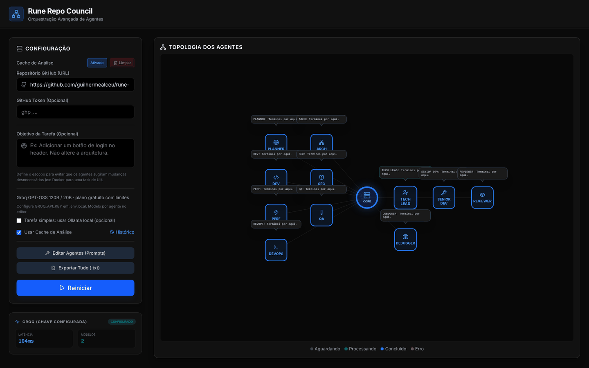
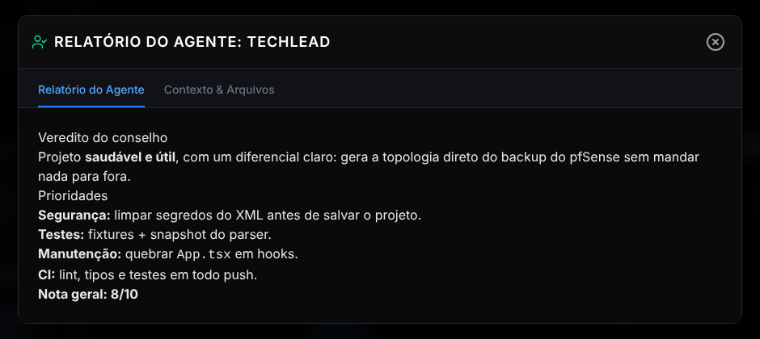

# Rune Repo Council

Um conselho de agentes de IA que revisa repositórios do GitHub: cada especialista analisa o código de um ângulo, um tech lead consolida e o resultado vira um relatório.



## Sobre

Revisar um repositório desconhecido leva tempo: entender a arquitetura, procurar falhas de segurança, ver o que está sem teste. O Rune Repo Council divide esse trabalho entre agentes especializados e junta tudo num relatório. Os agentes rodam por padrão no **Groq GPT-OSS**, de graça dentro da cota gratuita. O **Ollama local** fica como opção para tarefas simples, sem enviar nada para fora.

## Funcionalidades

- **Especialistas configuráveis**: Arquitetura, Desenvolvimento, Segurança (AppSec), Performance, QA, DevOps, Debugging/SRE e Planejamento, e você pode criar os seus
- **Tech Lead e Dev Sênior** consolidam as análises num parecer
- **Revisor** percorre o código arquivo por arquivo
- **Modelo por agente**: GPT-OSS 120B ou 20B, ou Ollama local para tarefas simples
- **Prompts editáveis** para cada agente
- **Relatório em Markdown** salvo localmente, com histórico das análises
- Repositórios públicos ou privados (com token do GitHub)

## Telas


<sub>Relatório consolidado do tech lead</sub>

## Requisitos

- Node.js 20+
- Uma chave do [Groq](https://console.groq.com/keys) (o plano gratuito atende)
- [Ollama](https://ollama.com) (opcional), para as tarefas simples

## Como rodar

```bash
npm install
cp .env.example .env.local   # preencha GROQ_API_KEY
npm run dev
```

Abra http://localhost:3007. A chave do Groq fica só no servidor, fora do navegador e do build.

Para validar: `npm run lint`, `npm test` e `npm run build`.

### Limites do plano gratuito do Groq

Por modelo: 30 requisições por minuto, 1.000 por dia, 8.000 tokens por minuto e 200.000 por dia (sujeito aos limites da sua conta). Em repositórios grandes, use o GPT-OSS 20B nos agentes menos críticos.

## Autor

Criado por **Guilherme Dill** · [RUNE Projects](https://www.runeprojects.com.br) · [GitHub](https://github.com/guilhermealceu)

## Licença

[MIT](LICENSE)
